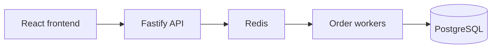

# Flash Sale

## System Design



The system uses TypeScript, Fastify, React + Vite, Redis and PostgreSQL. Redis Lua atomically checks the sale window, prevents duplicate allocations and reserves stock in Redis execution order. It also enqueues accepted purchases in Redis Streams. Workers process reservations asynchronously and commit orders to PostgreSQL, keeping database writes off the purchase admission path. API and worker replicas can scale independently; PostgreSQL uniqueness constraints and a per-sale final stock cap protect committed orders from duplicates and overselling.

Admission returns after the Redis primary acknowledges execution, favoring low latency over crash-safe reservation durability. AOF every second and asynchronous replication can lose acknowledged reservations on Redis failure; only a committed PostgreSQL order represents final success. Surviving reservations can be retried after worker or database failures. Redis remains the single-sale admission bottleneck, status polling can lag, and the local deployment does not provide automatic failover or host/region redundancy.

### Comprehensive System Design

> **[Read the complete system design →](docs/system-design.md)**
>
> Explore the full architecture, request flows, design decisions and recovery behavior.

## Build & Run

Run commands from the repository root. Install Node.js 22.23.2 and pnpm 11.25.0, and start Docker with Compose support and Linux containers. Keep local ports 8080, 5432 and 6379 available; browser tests also use 4173.

Install dependencies, build all packages and applications, start infrastructure, and apply migrations:

```sh
cp .env.example .env
pnpm install --frozen-lockfile
pnpm build
docker compose up -d --wait postgres redis redis-replica
pnpm db:migrate
```

Configure a sale before it opens. This example starts in five minutes and lasts one hour:

```sh
SALE_START=$(node -p 'new Date(Date.now()+300000).toISOString()')
SALE_END=$(node -p 'new Date(Date.now()+3900000).toISOString()')
pnpm sale:configure flash-sale "$SALE_START" "$SALE_END" 100
```

Start the API server, order workers, frontend and proxy:

```sh
docker compose up --build -d --wait
```

Open [the frontend](http://localhost:8080/?sale=flash-sale). The API is available through the same origin under `/api`; readiness is at [`/api/health/ready`](http://localhost:8080/api/health/ready). Enter a nonempty buyer identifier to purchase; each normalized identifier can receive one unit per sale.

The configuration command accepts `ID START_ISO END_ISO STOCK`. Existing sale times and initial stock cannot be changed. Use a new ID for another sale and open `/?sale=that-id`; an identical configuration can be retried safely.

Inspect or stop the running services:

```sh
docker compose ps
docker compose logs --tail=100 api worker
docker compose stop
```

Use `docker compose start` to resume stopped services. Named volumes retain sale and order data.

Run static checks and tests:

```sh
pnpm typecheck
pnpm lint
pnpm test
pnpm test:integration
pnpm exec playwright install chromium
pnpm test:browser
pnpm test:failure
```

`pnpm test` runs unit and harness tests. Integration and failure tests start isolated Docker Compose projects; browser tests start Vite automatically and use stub HTTP responses. Integration cleanup removes its disposable volumes; failure runs retain their own volumes for inspection. See [testing documentation](docs/testing.md) for coverage and details.

## Stress Test

### Running Instruction

With dependencies installed and Docker running, select a quick correctness check, the opening-second spike, or the full default suite:

```sh
pnpm test:stress no-oversell duplicates
pnpm test:stress spike-10k
pnpm test:stress
```

Each attempt builds and runs an isolated Compose project with its own sale and volumes. Cleanup removes only that project's disposable test volumes. Results, request timings, service logs and resource samples are written to `test-results/stress/<project>/<scenario>/`.

### Summary

Expected outcomes are stock conservation, no overselling, at most one allocation/order per normalized identifier, and completion of every surviving admitted reservation. Healthy runs must preserve every acknowledged reservation. Busy and sold-out responses are reported separately from transport errors and uncertain responses; dispatch timing and order completion are measured independently.

For `spike-10k`, the acceptance target is 10,000 request writes within one second, all 100 units sold, admission-to-committed-order visibility p99 below 2,000 ms, and every admitted order completed within 10,000 ms. These are acceptance targets, not a claim of measured capacity or crash-safe admission durability.

### Comprehensive Stress Test Documentation

> **Comprehensive stress-test documentation is pending.**
>
> **[Read the stress harness guide →](scripts/stress/README.md)** for current scenarios, configuration and acceptance checks.
