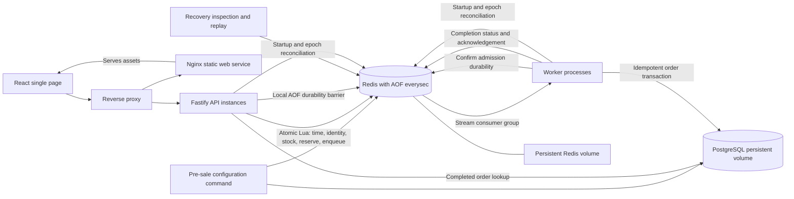

# Architecture

This integrates the [authored design](https://linear.app/bookipi-assessment/document/architecturemd-repository-ready-draft-5455c52fe11e) with the implementation for DEV-20. Design guarantees are conditional on the assumptions below; measured capacity is reported separately in [stress results](stress-results.md).

## Scope and components

The platform demonstrates one flash sale for one implicit product. A generic, normalized nonempty identifier identifies a buyer. Each buyer may secure one unit per sale. There is no authentication, payment, shipping, fraud evaluation, product catalogue, or quantity selection.

The implementation uses TypeScript, Fastify, React, Redis, PostgreSQL and Docker Compose. API instances and worker processes scale independently. Redis is the single authoritative admission mechanism for one sale. PostgreSQL stores completed orders. Only flash_sale and order application tables exist.

## Admission

The API normalizes the identifier by trimming whitespace and lowercasing. Empty input is invalid. Characters such as @ and . have no special meaning. Operational request-size protections are documented separately and are not email/username business rules.

A Lua script checks replay of the logical request key, existing buyer allocation, sale time and available stock. Successful admission reserves one unit, records the request/identifier association and appends work to the stream. These operations cannot interleave with another admission.

Redis server time is authoritative for admission. The sale-status endpoint uses the API wall clock and the browser renders its own countdown; those displays do not authorize admission. Eligibility is starts_at <= admission_time < ends_at. A request received by an API before end but evaluated by Redis after end is too late. There is no scheduler whose timely execution is necessary for opening/closing. The browser countdown is informational. Clock synchronization on the Redis host is an operating assumption.

Fairness means Redis atomic admission execution order. It does not mean browser click order, API response order or worker completion order. With reservations assigned at admission, later worker completion cannot take stock from an earlier admitted buyer. Original stream IDs order same-millisecond admissions; admission timestamps alone do not break ties. Recovery replacement IDs order reconstructed delivery, not original admission, and do not reassign allocations.

Lua isolation is not rollback on arbitrary script errors. The script validates inputs/key types before mutation; key ownership and noeviction reduce predictable partial-error risks. Unexpected invariant violations make the system unavailable for reconciliation rather than triggering guessed stock repair.

## Durability and acknowledgement

Redis AOF uses everysec and a persistent volume. In-memory execution alone is not a successful placement acknowledgement. The API confirms local AOF persistence with WAITAOF after the admission write on its owning connection, checking the returned local confirmation count. Connection pooling/batching must preserve that ordering without blocking unrelated commands behind durability waits.

On confirmation the page can say order placed and PROCESSING. On timeout or lost connection the page remains PROCESSING/confirming; the result is uncertain. The operation may already exist or may subsequently be lost before persistence. AOF everysec without the barrier would not meet the acknowledged-admission guarantee.

Lookup and same-key replay cannot bypass confirmation. A worker must also establish the admission record's durability before finalizing its order; reading an entry is not itself durability evidence. A checkpoint write followed by a local barrier can establish an AOF prefix including earlier admission data, but its exact implementation must be proven against the pinned Redis version.

### Exact confirmation protocol

[DurableAdmission](../packages/redis/src/sales/durability.ts) takes a slot before opening a distinct socket for each operation. The default is 16 concurrent sockets per API or worker gate, batch size one, no waiting queue. Offline buffering and automatic reconnection are disabled; the socket is destroyed on completion or deadline. The 3,000 ms deadline covers connection, validation, script and barrier. Blocking stream reads use a separate connection.

Each operation checks AOF configuration, noeviction and AOF write health. The [confirmation script](../packages/redis/src/sales/durability-scripts.ts) checks the recovery fence, absence of a fault latch, non-expiring state, identifier/request/reservation associations and exact stream payload. It increments `confirmation_checkpoint` in the sale hash on the same socket, then runs `WAITAOF 1 0 <timeout>` and requires the local count to equal one. This applies to fresh placement, allocated replay, duplicate lookup and worker confirmation. Non-allocation outcomes also receive a barrier before a definitive response.

Redis is pinned to 7.4.8. Its WAITAOF tracks the calling client's write offset: a fresh socket's wait alone cannot confirm another socket's writes. The checkpoint advances that client's offset past the validated reservation and stream writes; confirming that global AOF prefix covers the earlier admission. It neither forces immediate fsync nor establishes replica quorum. Independent sockets avoid head-of-line blocking behind another operation's wait, but disk cadence and connection overhead still limit throughput.

A timeout, disconnect, malformed reply, persistence failure or fence leaves placement PROCESSING/confirming and workers unable to finalize. Gate saturation before send returns retryable busy; lookup saturation remains confirming. A client disconnect does not cancel a potentially sent command or release stock. An already-placed response can carry an existing order still in confirming state; it is not a queued durability acknowledgement.

Evidence lives in [durability unit tests](../packages/redis/src/sales/durability.test.ts), [integration tests](../tests/integration), and [failure tests](../tests/failure). The fsync-suppression regression distinguishes unrelated-connection waits from writer/checkpoint waits; crash cases cover before/after Lua, blocked WAITAOF, confirmation before response, AOF rewrite and network reply loss. See [failure matrix](failure-matrix.md) for exact coverage and its limits.

## Processing

Workers use a Redis Stream consumer group and reclaim abandoned pending messages. Delivery may repeat. After admission durability is established, PostgreSQL records an order in a transaction with a unique(sale,user_identifier) constraint. A matching existing order is success on replay. The worker then repairs Redis completion status and acknowledges the stream entry.

A worker crash after database commit but before acknowledgement causes repeat processing, not another order. A lost commit response is resolved by querying/retrying against the unique constraint. Reservations are not released on transient errors, slow processing or retry exhaustion. Backoff and finite automatic retries lead to a durable delayed-recovery state, with operator replay available.

No post-admission business rejection is defined. Payment failures, fraud checks, shipping/eligibility rejection and inventory discrepancies from external systems are absent. Valid admitted orders are expected eventually to succeed given service recovery/manual remediation and intact persistent storage. This is not a guarantee of a fixed completion time during outage.

## Public states and retries

* NOT_ORDERED: initial client state; the current public route also returns it for missing reservations (see the contract gap below).
* PROCESSING/confirming: admission outcome/durability uncertain.
* PROCESSING/queued or processing: reservation confirmed, final order pending.
* PROCESSING/delayed: retry metadata or quarantine exists, including retry backoff and exhaustion; allocation retained.
* SUCCESS: PostgreSQL order committed.
* REJECTED: definitive admission failure, with upcoming/ended/sold_out/already_placed or input reason.

A rejected new placement does not change an existing order's successful or pending state. The frontend holds a request key in memory for accidental duplicate submissions and retries. A refresh need not preserve the key; sale+normalized identifier lookup recovers current order state. Deliberate new placement uses a new key and explicitly reports already placed. No public attempt ID is required.

## Recovery and ambiguity

On Redis restart, admission is fenced until persisted reservations/messages and PostgreSQL orders are reconciled. Inventory accounts for both pending reservations and committed allocations without double counting. It must never be reset from initial stock minus committed orders alone.

Absence in a lookup cannot alone establish rejection: an old request could still execute or recovery could be incomplete. A definitive non-admission requires an ordering/fencing proof that original commands cannot arrive later. If that cannot be established, remain confirming/unavailable and require recovery; do not report a fabricated rejection.

### Epoch fence and reconciliation

[Service startup/readiness](../apps/api/src/service.ts) is shared with workers. Each process caches the Redis run ID per reconciled sale. On startup or epoch change it reads that sale's complete PostgreSQL order snapshot and invokes recovery. There is no leader lease: replicas may independently run reconciliation; Redis serializes their scripts. This can briefly fence traffic again. A snapshot racing a worker commit is safe because the allocation remains retained and the worker/replay can repair its completion marker.

[Recovery](../packages/redis/src/sales/durability-scripts.ts) clears `recovered_run`, validates immutable configuration and checks `initial_stock = remaining_stock + retained reservations`. It validates both mappings, outcome/retry schemas, timestamps, key types and absence of TTLs. Completed allocations remain reservations and count exactly once. Every DB order must match an allocation and its admission timestamp.

If a valid reservation has lost its stream entry, recovery appends replacement work, updates its stream pointer and transfers retry/quarantine metadata in the atomic script. Matching DB orders repair completion mappings. Conflicting state, unexplained counts or `admission_fault` leave the fence closed with diagnostics. Recovery never recreates inventory from DB counts, increments stock or clears a fault latch automatically. Repairs performed before a later validation failure remain fenced for a safe rerun or operator investigation; Lua is not rollback.

Only successful validation writes the current Redis `INFO server` run_id into `recovered_run`, advances the checkpoint and then waits for local AOF persistence. Admission and confirmation compare the stored run with the live run inside Lua; a persisted old fence cannot authorize a restarted Redis. Even if another operation runs between recovery's script and barrier, it still needs its own confirmation. Previously issued process-local durable evidence remains valid across a restart with intact storage.

The epoch fence prevents execution while recovery is incomplete. It does **not** prove an old API command can never execute after recovery reopens. Consequently there is no definitive-absence proof implemented: the durability library returns confirming (`missing_without_absence_proof`) for missing reservations, including after recovery. A completed admission script's durable rejection applies to that logical request key; it is not proof of absence for every possible in-flight request.

### Known public-lookup contract gap

The current [API allocated lookup](../apps/api/src/sales/routes.ts) converts `missing_without_absence_proof` to NOT_ORDERED after a DB absence check and readiness reconciliation. Its comment treats the current-run fence as an absence proof, but that fence does not prevent a delayed command executing after reopening. This differs from the approved conservative uncertainty contract and the library behavior above. NOT_ORDERED from this route must not be interpreted as proof that an in-flight purchase was rejected. Correcting the route and its observable tests is unresolved runtime work; DEV-20 documents the conflict without changing the approved requirement or implementation. Library-level delayed-admission tests do not prove the public route satisfies it.

Operator commands and bounded replay are in [recovery operations](recovery.md). Do not trim, expire, evict or manually mutate retained keys. Missing-entry reconstruction is a defensive recovery capability, not permission for routine stream deletion.

## Scaling and limits

The API and workers can scale horizontally around shared admission/storage. Redis admission rejections avoid a PostgreSQL inventory-reservation transaction; routes still query PostgreSQL for sale configuration, readiness and order lookup. Slow processing does not keep admission transactions open. Pool/queue bounds and retryable pre-admission busy responses control overload; a post-send uncertainty is not a pre-admission rejection.

Redis remains a shared single-sale throughput and availability limit. AOF, CPU, network, proxy, database processing and generator capacity all require measurement. Partitioned inventory allocations and controlled edge admission are future options at larger/global scale; partitioning requires reconsidering strict global admission order and identity enforcement.

A short PostgreSQL reservation transaction is a valid alternative and need not wait for full order processing. Its contention and write capacity are workload-dependent. This project chooses Redis admission to isolate contention and decouple the processing path, not because a universal stock/request threshold proves PostgreSQL inadequate.

Local crash/restart recovery assumes intact persistent volumes and correct storage synchronization. Volume loss/corruption, host failure redundancy and regional failover are out of scope. Production would require a broader replication/durability and recovery design.

Sources: [Redis Streams](<https://redis.io/docs/latest/develop/data-types/streams/>), [Redis persistence](<https://redis.io/docs/latest/operate/oss_and_stack/management/persistence/>), [WAITAOF](<https://redis.io/docs/latest/commands/waitaof/>).

## Implementation map and retained key schema

[Key construction](../packages/redis/src/sales/configuration.ts) uses `sale:{<UTF-8 sale ID encoded as hex>}:admission`. The braces put all suffixes in one Redis Cluster slot; the deployed authority is a single Redis instance.

| Suffix | Type | Contents |
| --- | --- | --- |
| none | hash | `configuration_version=1`, `starts_at`, `ends_at` (epoch ms), `initial_stock`, `remaining_stock`; `recovered_run`, `confirmation_checkpoint`, `replay_checkpoint` after operator replay; optional `admission_fault` / `recovery_diagnostic` |
| `:identifiers` | hash | normalized identifier → original allocated request key |
| `:requests` | hash | allocated request key → normalized identifier |
| `:reservations` | hash | request key → JSON `{identifier, admittedAtMs, streamId}` |
| `:stream` | stream | `sale_id`, `identifier`, `request_key`, `admitted_at_ms`; consumer group `orders` |
| `:outcomes` | hash | non-allocation request key → JSON identifier/reason binding |
| `:completed` | hash | normalized identifier → committed order UUID |
| `:retries` | hash | stream ID → version-1 JSON attempts, nextAt, reason, exhausted and optional completed flag |
| `:retry_due` | sorted set | stream ID scored by next eligible epoch ms |
| `:quarantine` | hash | stream ID → identity conflict diagnostic |

All evidence is retained without TTL. Outcome storage also grows with rejected distinct request keys, not just admitted stock. The [admission script](../packages/redis/src/sales/admission-script.ts) sets a fault latch before mutation and clears it only after protected writes succeed.

The [worker](../apps/worker/src/orders/consumer.ts) uses separate blocking/command sockets, COUNT 10 reads/claims, 250 ms blocking reads and 60,000 ms abandoned-message reclaim. Each worker processes sequentially. It matches request key, stream ID and admission timestamp against durable evidence before calling [persistOrder](../packages/database/src/sales/orders.ts). PostgreSQL INSERT ON CONFLICT DO NOTHING followed by matching-timestamp lookup returns the existing UUID on replay; a mismatched timestamp is quarantined. Unknown COMMIT results discard the connection and retry this same identity. Completion hash writes and XACK are repeatable hints; PostgreSQL remains the final order authority. XACK does not delete the stream entry.

The [two-table schema](../packages/database/src/sales/schema.ts) has immutable `flash_sale` configuration and `"order"` with a sale foreign key, admission/completion timestamps and UNIQUE(flash_sale_id, user_identifier). Admission reserves inventory; AOF confirmation establishes admission persistence; the PostgreSQL transaction finalizes an order. Neither later step consumes another unit.

Exact runtime versions, retry/poll defaults, operational bounds and measured limitations are in [decisions](decisions.md). Public route shapes and input limits are in [public contract](public-contract.md).
