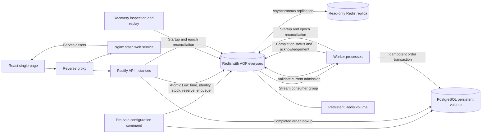

# Architecture

This integrates the [authored design](https://linear.app/bookipi-assessment/document/architecturemd-repository-ready-draft-5455c52fe11e) with the implementation for DEV-20. Design guarantees are conditional on the assumptions below; measured capacity is reported separately in [stress results](stress-results.md).

## Final stock protection after admission loss

The user approved a final PostgreSQL stock cap after review reproduced an in-flight
commit/recovery race. Every application order transaction uses READ COMMITTED and
locks its flash_sale row, then checks for an existing matching order before counting
committed orders. New orders cannot exceed initial_stock; matching replay succeeds
at full capacity. This adds no database operation to Redis acknowledgement.

A capacity conflict is quarantined and sets admission_fault=committed_order_capacity,
fencing new admissions for operator reconciliation. No reservation is silently
released. PostgreSQL commits are serialized per sale; the schema remains two tables.
The [before/after race](admission-loss-crash-race.md) documents the approval and
regression. This protects final order count, not survival of every acknowledged
Redis reservation or availability after arbitrary state loss.

## Scope and components

The platform demonstrates one flash sale for one implicit product. A generic, normalized nonempty identifier identifies a buyer. Each buyer may secure one unit per sale. There is no authentication, payment, shipping, fraud evaluation, product catalogue, or quantity selection.

The implementation uses TypeScript, Fastify, React, Redis, PostgreSQL and Docker Compose. API instances and worker processes scale independently. Redis is the single authoritative admission mechanism for one sale. PostgreSQL stores completed orders. Only flash_sale and order application tables exist.

## Admission

The API normalizes the identifier by trimming whitespace and lowercasing. Empty input is invalid. Characters such as @ and . have no special meaning. Operational request-size protections are documented separately and are not email/username business rules.

A Lua script checks replay of the logical request key, existing buyer allocation, sale time and available stock. Successful admission reserves one unit, records the request/identifier association and appends work to the stream. These operations cannot interleave with another admission.

Redis server time is authoritative for admission. The sale-status endpoint uses the API wall clock and the browser renders its own countdown; those displays do not authorize admission. Eligibility is starts_at <= admission_time < ends_at. A request received by an API before end but evaluated by Redis after end is too late. There is no scheduler whose timely execution is necessary for opening/closing. The browser countdown is informational. Clock synchronization on the Redis host is an operating assumption.

Fairness means Redis atomic admission execution order. It does not mean browser click order, API response order or worker completion order. With reservations assigned at admission, later worker completion cannot take stock from an earlier admitted buyer. Original stream IDs order same-millisecond admissions; admission timestamps alone do not break ties. Recovery replacement IDs order reconstructed delivery, not original admission, and do not reassign allocations.

Lua isolation is not rollback on arbitrary script errors. The script validates inputs/key types before mutation; key ownership and noeviction reduce predictable partial-error risks. Unexpected invariant violations make the system unavailable for reconciliation rather than triggering guessed stock repair.

## Acknowledgement and accepted loss risk (16 October 2026)

The API returns PROCESSING/queued as soon as the primary acknowledges the atomic
reservation Lua script. There is no WAITAOF or WAIT, and no post-admission
PostgreSQL lookup on the purchase response path. Same-key replay returns the
acknowledged reservation state; use GET order status to observe a committed order.
A duplicate identifier with a new key returns already_placed plus PROCESSING.

This user-approved decision supersedes the prior local-AOF acknowledgement
contract. Acknowledgement means primary-memory acceptance, not disk persistence,
replica receipt or a final order. A crash/failover before persistence/replication
can lose an acknowledged admission, including its stock reservation, deduplication
keys and stream entry. PostgreSQL committed orders remain the final authority.
AOF everysec remains enabled on the primary and replica as background persistence.

### One asynchronous replica

Both demonstration and isolated test Compose projects include exactly one
`redis-replica`, configured with `--replicaof redis 6379`, read-only access and its
own persistent volume. Health checks require the primary replication link up.
API/worker reads and writes stay on `redis`; they never use stale replica reads
for allocation or order status. The replica is not a required acknowledgement,
and the application continues when it is offline. No Sentinel, automatic
promotion, client failover or separate-host redundancy is implemented. Primary
restart can resynchronize the replica to older data; replica presence does not
make an acknowledged write loss-proof.

### Bounded admission and validation

[RedisAdmission](../packages/redis/src/sales/acknowledgement.ts) takes one of 16
concurrent slots per service before opening an operation-owned socket. The
3,000-ms deadline covers connection, validation and Lua. There is no waiting
queue, offline buffering or automatic command replay. Other application/HTTP
limits are unchanged; 16 slots are a concurrency bound, not a requests/second rate.

Each operation checks AOF everysec/noeviction configuration and write health.
[Lookup validation](../packages/redis/src/sales/state-scripts.ts) checks the epoch
fence, fault latch, absence of TTLs, mappings, reservation and stream payload. It
is a validation of current primary state, not durability evidence. Workers perform
this validation before PostgreSQL persistence without a disk/replica barrier.
Retry claims, configuration, recovery and operator replay also use plain Redis
acknowledgements; their metadata has the same accepted loss risk.

A Redis reply lost after possible execution remains uncertain. The API exposes
NOT_ORDERED/confirmation_uncertain and same-key retry, rather than inventing a
successful acknowledgement or definitive rejection. Capacity exhaustion before
send returns busy. These transport outcomes are distinct from acknowledged data
subsequently lost in a crash.

Evidence: [acknowledgement unit tests](../packages/redis/src/sales/acknowledgement.test.ts),
[replication tests](../tests/integration/replication.test.ts),
[loss simulation](../tests/integration/admission-loss.test.ts), and
[crash tests](../tests/failure/durability.test.ts). The loss simulation deliberately
restores an older consistent reservation snapshot; SIGKILL alone usually retains
OS page-cache writes and is not a deterministic simulation of host power loss.

## Processing

Workers use a Redis Stream consumer group and reclaim abandoned pending messages. Delivery may repeat. After current admission identity is validated, PostgreSQL records an order under the sale-row stock cap and unique(sale,user_identifier) constraint. A matching existing order is success on replay. The worker then repairs Redis completion status and acknowledges the stream entry.

A worker crash after database commit but before acknowledgement causes repeat processing, not another order. A lost commit response is resolved by querying/retrying against the unique constraint. Reservations are not released on transient errors, slow processing or retry exhaustion. Backoff and finite automatic retries lead to a delayed-recovery state in Redis, with operator replay available.

No post-admission business rejection is defined. Payment failures, fraud checks, shipping/eligibility rejection and inventory discrepancies from external systems are absent. Surviving admitted reservations are expected eventually to succeed given service recovery/manual remediation. Acknowledged Redis admissions may instead be lost before PostgreSQL commit. This is not a guarantee of a fixed completion time during outage.

## Public states and retries

* NOT_ORDERED: initial client state; the current public route also returns it for missing reservations (see public uncertainty semantics below).
* NOT_ORDERED/confirmation_uncertain: admission outcome unresolved; retry the same key. PROCESSING/confirming remains an internal library state.
* PROCESSING/queued or processing: primary acknowledged reservation, final order pending.
* PROCESSING/delayed: retry metadata or quarantine exists, including retry backoff and exhaustion; allocation retained.
* SUCCESS: PostgreSQL order committed.
* REJECTED: definitive admission failure, with upcoming/ended/sold_out/already_placed or input reason.

A rejected new placement does not change an existing order's successful or pending state. The frontend holds a request key in memory for accidental duplicate submissions and retries. A refresh need not preserve the key; sale+normalized identifier lookup recovers current order state. Deliberate new placement uses a new key and explicitly reports already placed. No public attempt ID is required.

## Recovery and ambiguity

On Redis restart, admission is fenced until persisted reservations/messages and PostgreSQL orders are reconciled. Inventory accounts for both pending reservations and committed allocations without double counting. It must never be reset from initial stock minus committed orders alone.

Absence in a lookup cannot alone establish rejection: an old request could still execute or recovery could be incomplete. A definitive non-admission requires an ordering/fencing proof that original commands cannot arrive later. If that cannot be established, preserve internal uncertainty; public NOT_ORDERED is an observation rather than a definitive rejection.

### Epoch fence and reconciliation

[Service startup/readiness](../apps/api/src/service.ts) is shared with workers. Each process caches the Redis run ID per reconciled sale. On startup or epoch change it reads that sale's complete PostgreSQL order snapshot and invokes recovery. There is no leader lease: replicas may independently run reconciliation; Redis serializes their scripts. This can briefly fence traffic again. A snapshot racing a worker commit is safe because the allocation remains retained and the worker/replay can repair its completion marker.

[Recovery](../packages/redis/src/sales/state-scripts.ts) clears `recovered_run`, validates immutable configuration and checks `initial_stock = remaining_stock + retained reservations`. It validates both mappings, outcome/retry schemas, timestamps, key types and absence of TTLs. Completed allocations remain reservations and count exactly once. Every DB order must match an allocation and its admission timestamp.

If a valid reservation has lost its stream entry, recovery appends replacement work, updates its stream pointer and transfers retry/quarantine metadata in the atomic script. Matching DB orders repair completion mappings. Conflicting state, unexplained counts or `admission_fault` leave the fence closed with diagnostics. Recovery never recreates inventory from DB counts, increments stock or clears a fault latch automatically. Repairs performed before a later validation failure remain fenced for a safe rerun or operator investigation; Lua is not rollback.

Only successful reconciliation writes the current Redis run_id into recovered_run.
Admission and lookup compare this epoch inside Lua, so a persisted old fence does
not authorize a restarted primary. No disk/replica acknowledgement is awaited.
If PostgreSQL contains committed orders whose Redis allocation metadata was lost,
readiness stays closed for operator repair rather than risking overselling. This
case is not automatically reconstructed from database counts.

The fence does not prove an old API command cannot execute after recovery reopens.
Missing reservations are observational absence, not definitive rejection of every
in-flight request. Lost acknowledged admissions can be retried with the original
key; current window and stock rules still apply if the key itself was lost.

### Public uncertainty semantics (user-approved revision)

Public NOT_ORDERED means no order/reservation is currently observed, not proof
that a delayed request cannot execute. Failed or uncertain lookup retains the
previous UI state. A successful fresh empty lookup may now clear PROCESSING,
because its acknowledgement is provisional until PostgreSQL commit. The page
shows “Your reservation is no longer available. Please try again.” and retains
the in-memory request key. SUCCESS never regresses. Lookup generations still
prevent pre-submission responses or another identifier from erasing newer state.
A retry after sale closure or sellout may be rejected if the admission was lost.

Operator commands and bounded replay are in [recovery operations](recovery.md). Do not trim, expire, evict or manually mutate retained keys. Missing-entry reconstruction is a defensive recovery capability, not permission for routine stream deletion.

## Scaling and limits

The API and workers can scale horizontally around shared admission/storage. Redis admission rejections avoid a PostgreSQL inventory-reservation transaction; routes still query PostgreSQL for sale configuration, readiness and order lookup. Slow processing does not keep admission transactions open. Pool/queue bounds and retryable pre-admission busy responses control overload; a post-send uncertainty is not a pre-admission rejection.

Redis remains a shared single-sale throughput and availability limit. AOF, CPU, network, proxy, database processing and generator capacity all require measurement. Partitioned inventory allocations and controlled edge admission are future options at larger/global scale; partitioning requires reconsidering strict global admission order and identity enforcement.

A short PostgreSQL reservation transaction is a valid alternative and need not wait for full order processing. Its contention and write capacity are workload-dependent. This project chooses Redis admission to isolate contention and decouple the processing path, not because a universal stock/request threshold proves PostgreSQL inadequate.

Local crash/restart recovery assumes intact persistent volumes and correct storage synchronization. Volume loss/corruption, host failure redundancy and regional failover are out of scope. Production would require a broader replication/durability and recovery design.

Sources: [Redis Streams](<https://redis.io/docs/latest/develop/data-types/streams/>), [Redis persistence](<https://redis.io/docs/latest/operate/oss_and_stack/management/persistence/>), [Redis replication](<https://redis.io/docs/latest/operate/oss_and_stack/management/replication/>).

## Implementation map and retained key schema

[Key construction](../packages/redis/src/sales/configuration.ts) uses `sale:{<UTF-8 sale ID encoded as hex>}:admission`. The braces put all suffixes in one Redis Cluster slot; the deployed authority is one Redis primary with one asynchronous replica.

| Suffix | Type | Contents |
| --- | --- | --- |
| none | hash | `configuration_version=1`, `starts_at`, `ends_at` (epoch ms), `initial_stock`, `remaining_stock`; `recovered_run`, `replay_checkpoint` after operator replay; optional `admission_fault` / `recovery_diagnostic` |
| `:identifiers` | hash | normalized identifier → original allocated request key |
| `:requests` | hash | allocated request key → normalized identifier |
| `:reservations` | hash | request key → JSON `{identifier, admittedAtMs, streamId}` |
| `:stream` | stream | `sale_id`, `identifier`, `request_key`, `admitted_at_ms`; consumer group `orders` |
| `:outcomes` | hash | non-allocation request key → JSON identifier/reason binding |
| `:completed` | hash | normalized identifier → committed order UUID |
| `:retries` | hash | stream ID → version-1 JSON attempts, nextAt, reason, exhausted and optional completed flag |
| `:retry_due` | sorted set | stream ID scored by next eligible epoch ms |
| `:quarantine` | hash | stream ID → identity conflict diagnostic |

All evidence is retained without TTL. Outcome storage also grows with rejected distinct request keys, not just admitted stock. The [admission script](../packages/redis/src/sales/admission-script.ts) sets a fault latch before mutation and clears it only after protected writes succeed.

The [worker](../apps/worker/src/orders/consumer.ts) uses separate blocking/command sockets, COUNT 10 reads/claims, 250 ms blocking reads and 60,000 ms abandoned-message reclaim. Each worker processes sequentially. It matches request key, stream ID and admission timestamp against current primary reservation state before calling [persistOrder](../packages/database/src/sales/orders.ts). PostgreSQL takes the sale-row lock, looks up existing identity before the capacity check and uses INSERT ON CONFLICT DO NOTHING for new orders. Matching-timestamp replay returns the existing UUID; a mismatched timestamp is quarantined. A new order at committed capacity is quarantined and fences admission. Unknown COMMIT results discard the connection and retry this same identity. Completion hash writes and XACK are repeatable hints; PostgreSQL remains the final order authority. XACK does not delete the stream entry.

The [two-table schema](../packages/database/src/sales/schema.ts) has immutable `flash_sale` configuration and `"order"` with a sale foreign key, admission/completion timestamps and UNIQUE(flash_sale_id, user_identifier). Admission reserves inventory and returns its acknowledgement without waiting for persistence; the PostgreSQL transaction finalizes an order without consuming another unit.

Exact runtime versions, retry/poll defaults, operational bounds and measured limitations are in [decisions](decisions.md). Public route shapes and input limits are in [public contract](public-contract.md).
