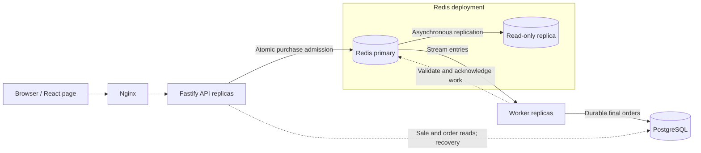
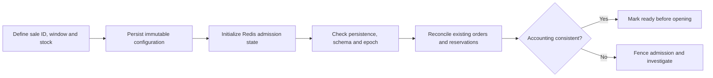
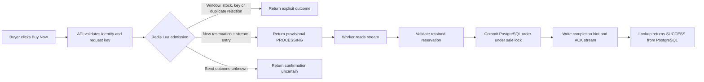
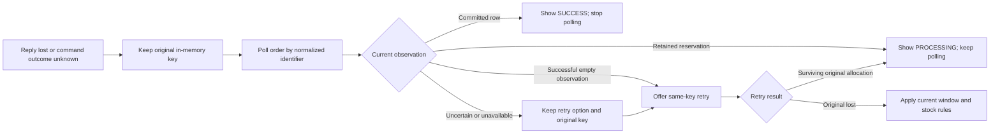
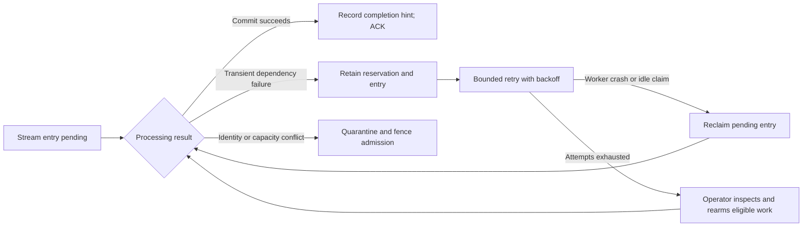

# Flash sale system design

## 1. Goal, scale, and mental model

### Goal

Allocate limited inventory safely when many buyers compete for one product, acknowledge admission promptly, and complete orders asynchronously. Each normalized identifier can obtain at most one unit per sale. The system must handle overload, retries, crashes, and recovery with explicit correctness and durability boundaries.

The application consists of one purchase page, an API, workers, Redis, and PostgreSQL. There are exactly two application tables: `flash_sale` and `order`. Multiple sale IDs are supported; the product itself has no table or catalogue.

### Scale

This is a highly anticipated flash sale: thousands of users will attempt to purchase the same product simultaneously when the sale opens. Demand is concentrated around the opening instant rather than spread evenly through the sale window. Limited stock means the system must handle far more attempts than successful orders, while repeated clicks and retries add contention for the same inventory and identifiers.

Use 1,000 purchase attempts within one second as the initial contention case and 10,000 as the larger opening burst. Extend validation to 100,000 attempts within one second to examine saturation and recovery at a higher demand level. These are explicit design and validation targets; the description “thousands of simultaneous users” alone does not establish an exact request rate or justify a claim of 100,000 requests/second capacity.

Exercise those demand levels against 100 units to expose heavy oversubscription, and against 10,000 units at the largest burst to exercise substantial order persistence as well as rejection handling. Include repeated identifiers to distinguish request volume from eligible buyers. The system must preserve inventory and identity correctness at every level, even when overload reduces the number of requests reaching admission.

The one-second interval defines offered purchase traffic. Responses and asynchronous completion have separate latency requirements. Admission is limited by available inventory and system capacity; dispatching a burst does not imply that every request can become an order.

### Mental model

1. **Redis decides admission.** One Lua execution checks the sale window, identity, request key, stock, and safety fences, then reserves one unit and appends work. Its execution order is authoritative.
2. **Admission and completion are separate.** `PROCESSING` acknowledges a reservation on the Redis primary. `SUCCESS` means an order has committed to PostgreSQL.
3. **Streams make unfinished work discoverable.** Workers can reclaim and replay surviving entries. Internal failures do not intentionally release inventory.
4. **PostgreSQL protects the final ledger.** Identifier uniqueness prevents duplicate orders; a per-sale transaction lock and committed-order cap prevent excess final orders even after Redis admission-state loss.
5. **A missing reply is uncertainty.** The client retries an unresolved logical submission with the same key and polls by identifier. It cannot infer rejection from a timeout.

## 2. Scale numbers

### Demand and inventory planning cases

| Initial stock | Opening-second purchase attempts | Identifier mix | Design concern |
| ---: | ---: | --- | --- |
| 100 | 1,000 | Unique | Basic contention and conservation |
| 100 | 10,000 | Unique | Oversubscribed admission |
| 100 | 10,000 | 100 repeated identifiers | Duplicate allocation prevention |
| 100 | 100,000 | Unique | Extreme offered load |
| 10,000 | 100,000 | Unique | Larger successful write workload |

These cases separate buyer demand from scarce inventory and repeated requests from distinct eligible buyers. The validation plan must derive its bursts, boundary cases, sufficient-stock cases, and duplicate scenarios from these demand and correctness requirements.

### Runtime defaults and local resource budgets

| Setting | Value / behavior |
| --- | --- |
| Redis admission authority | One primary, one asynchronous read-only replica |
| Redis admission pool, per process | Starts at one connection and can grow to 100 |
| Pool acquisition timeout | 3 seconds |
| Admission operation timeout | Default 3,000 ms, after acquisition |
| Application HTTP concurrency guard | None; active requests are observed |
| PostgreSQL pool | Default 10 connections per API/worker process |
| Dependency acquisition/query timeout | Default 2,000 ms |
| Worker read/reclaim batches | Up to 10, handled sequentially per worker |
| Abandoned pending-entry reclaim threshold | 60,000 ms |
| Retry budget | Default 5 attempts; jittered exponential delay, 1,000-ms base, 60,000-ms cap |
| Redis persistence and memory | AOF every second; 256-MB maxmemory; noeviction |
| API/worker/PostgreSQL/Redis container budget | 1 CPU and 512 MiB per container |
| Local proxy and web container budget | 0.5 CPU and 64 MiB each |

Pool and resource limits are operational starting points, not capacity claims. Record their values with every load result; a run using a larger proxy budget does not establish capacity for the smaller local deployment.

## 3. Requirements

### Functional requirements

| Requirement | Required behavior |
| --- | --- |
| Configure a sale | CLI supplies ID, start/end timestamps, and initial stock before opening; identical retries are safe |
| Show sale state | Page displays upcoming, open, ended, or sold out, with countdown and observed stock |
| Accept an identifier | Generic nonempty text, trimmed and lowercased; no email/username syntax or authenticated account |
| Buy one unit | Valid new admission atomically reserves exactly one unit |
| Enforce window | Redis time must satisfy `starts_at <= now < ends_at` for a new admission |
| Prevent duplicate allocation | One normalized identifier per sale; deliberate new-key duplicate returns explicit feedback |
| Replay a submission | Same sale/key and normalized identifier reuses the surviving bound outcome |
| Complete asynchronously | Worker validates reservation identity, commits order, publishes completion hint, acknowledges stream delivery |
| Retrieve existing order | Identifier lookup returns committed success, current processing, uncertainty, or an empty observation |
| Recover unfinished work | Reclaim pending messages, retry transient failures, retain exhausted work for operator replay |
| Explain failure to users | Separate business rejection, service unavailability, provisional processing, and uncertain response |

There is no authentication, payment, fraud decision, shipping eligibility, cart, coupon system, quantity selector, catalogue, admin UI, or separate order-history page. There is no business rejection stage after valid admission and no reservation-expiry policy.

### Non-functional requirements

| Requirement | SLO / target | Rationale |
| --- | --- | --- |
| Opening demand | Plan for 1,000–10,000 purchase attempts in the opening second; validate saturation at 100,000 attempts in one second | Anticipation concentrates requests at opening; average sale-window traffic hides this peak |
| Inventory accuracy | Zero negative admission stock in consistent Redis state; committed order count never exceeds initial stock | A scarce unit must not be promised to multiple final buyers |
| Identifier uniqueness | At most one retained allocation and one committed order per normalized identifier per sale | Concurrent tabs and retries must not consume multiple units |
| Idempotency | Same sale/key and normalized payload reuses its retained outcome; changed payload conflicts | Network retries must resolve the original attempt rather than create another allocation |
| Order completion latency | For 100 stock and 10,000 unique opening-second attempts: admission-to-committed-order visibility p99 < 2 seconds, every order ≤ 10 seconds | Buyers need timely final confirmation; this measures successful order work separately from rejection traffic |
| Admission acknowledgement | Return after the primary acknowledges Lua execution; do not wait for `WAITAOF`, `WAIT`, or worker completion | Keep disk/replica confirmation and database processing off the acknowledgement path; accept provisional reservation loss on Redis failure |
| Final order durability | `SUCCESS` requires a committed PostgreSQL row; no regression from success; recovery assumes intact persistent storage | Provisional admission and final purchase must have unambiguous, different guarantees |
| Ordering | Redis execution order governs admission; no global HTTP-arrival FIFO guarantee | Multiple processes and network paths cannot share a reliable arrival clock |
| Consistency | Atomic stock/identity/work allocation in Redis; serialized per-sale final-order cap in PostgreSQL; status views may lag | Correctness decisions require coordination, while display freshness can tolerate delay |
| Overload behavior | Acquisition expiry before execution returns busy; possible-send failures remain uncertain; no stock release on timeout | Rejecting before admission and losing an acknowledgement require different retry behavior |
| Dependency bounds | Default 3-second pool acquisition, separate 3-second admission operation deadline, and 2-second DB acquisition/query timeout | Bound individual waits and expose stalls; these deadlines are not HTTP response SLOs |
| Horizontal operation | API and worker replica counts can change independently against shared Redis and PostgreSQL | Request handling and order drain have different resource needs; this does not promise linear scaling |
| Recovery | Retain surviving reservations through worker/database failure and retry exhaustion; fence inconsistent accounting before reopening | Infrastructure failure must not intentionally revoke stock ownership or create replenishment |
| Availability scope | No percentage availability SLO; local persistent-storage recovery only; host/region redundancy and storage loss/corruption excluded | A numerical uptime guarantee requires a redundancy and recovery scope beyond this design |
| Validation | Prove offered dispatch, outcome accounting, stock conservation, uniqueness, and latency independently | A fast rejection path or invalid generator interval cannot establish successful-order capacity |

Admission acknowledgement intentionally favors latency over crash-safe reservation durability. A provisional acknowledgement may be lost before PostgreSQL commit. Final committed-order durability and provisional admission durability are separate contracts; the UI and recovery process must preserve that distinction.

## 4. Scale estimations

Start with the opening-demand target and order-completion SLO, then estimate the work each layer must handle. The resulting traffic, inventory, and failure cases define the load tests. These calculations are planning bounds, not measured capacity or a guarantee that every offered request reaches the application.

### Traffic estimates

Let `C` be buyers attempting purchase at opening, `T` the interval over which they submit, `U` distinct eligible identifiers reaching admission, and `S` initial stock. Use one initial attempt per buyer to calculate base traffic; duplicate clicks and retries add attempts without adding eligible buyers.

| Metric | Calculation | Estimate / bound |
| --- | --- | --- |
| Initial opening demand | Planning range | 1,000–10,000 buyers attempting purchase |
| Primary opening purchase rate | 10,000 attempts / 1 second | 10,000 offered requests/second |
| Lower contention case | 1,000 attempts / 1 second | 1,000 offered requests/second |
| Saturation envelope | 100,000 attempts / 1 second | 100,000 offered requests/second to validate overload correctness |
| New allocations | `min(S, U)` | At most 100 or 10,000 in the inventory planning cases |
| Maximum allocation share, primary case | 100 units / 10,000 distinct attempts | 1% |
| Maximum allocation share, larger inventory case | 10,000 units / 100,000 distinct attempts | 10% |
| Repeated-identifier demand | 10,000 attempts / 100 identifiers | 100 attempts per identifier on average; at most 100 allocations |
| Admission Lua evaluations | One per purchase attempt that reaches execution | Up to the executed purchase rate, including rejected/replayed attempts |
| New stream entries | One per new allocation | At most `min(S, U)`; replay adds no new allocation |

The primary case can require roughly 10,000 admission decisions for only 100 new orders. Consequently API/Redis decision throughput and PostgreSQL successful-order throughput are separate sizing concerns. The larger inventory case exercises final-order work that a mostly sold-out scenario cannot represent.

### Order-processing estimates

| Metric | Calculation | Estimate / implication |
| --- | --- | --- |
| Primary-case final order volume | `min(100 stock, 10,000 eligible buyers)` | At most 100 new rows |
| First-pass two-second completion budget | 100 orders / 2 seconds | Approximately 50 completions/second across the initial cohort |
| First-pass ten-second completion budget | 100 orders / 10 seconds | Approximately 10 completions/second across the cohort |
| Per-sale serial service budget for 50 completions/second | 1 second / 50 | Approximately 20 ms per completed order on average across the serialized path |
| Larger-inventory final order volume | `min(10,000 stock, 100,000 eligible buyers)` | At most 10,000 new rows; drain must be measured independently |

The two-second and ten-second rates are rough cohort-sizing calculations. The SLO clock starts at each admission, not at a common batch timestamp; average throughput alone cannot establish p99 or maximum latency. Worker validation, scheduling, Redis operations, database lock waits, transaction work, and commit visibility all consume the budget. The 20-ms figure is a derived budget, not a database-latency guarantee. Do not extend the primary-case latency SLO to 10,000 successful orders without defining that additional requirement.

### Polling estimates

| Metric | Calculation | Estimate / implication |
| --- | --- | --- |
| Sale-status polling while open | `C / 5 seconds` | At 10,000 active pages, approximately 2,000 reads/second |
| Sale-status polling after ended/sold out | `C / 30 seconds` | At 10,000 active pages, approximately 333 reads/second |
| Pending order polling at maximum backoff | `P / 30 seconds`, where `P` is clients still polling | At 10,000 pending clients, approximately 333 lookups/second |
| Order lookup persistence reads | One PostgreSQL-first lookup per request | Read demand follows polling clients, not just successful orders |

These rates assume evenly spread polling and ignore response duration. Clients first check orders after 300 ms, then back off from one second to 30 seconds and stop on success. Synchronized page loads can produce sharper read bursts, while early retries add transient traffic. The 10,000-page example assumes the primary buyer cohort keeps its pages open; it is a planning scenario, not an additional measured traffic claim.

### Storage estimates

| Data | Calculation | Cardinality / storage implication |
| --- | --- | --- |
| Sale metadata and inventory | One configuration/stock record per sale | Independent of buyer count |
| Retained reservations | `S - remainingStock` | Up to 100 or 10,000 per inventory case |
| Identifier and allocated-request mappings | One entry in each map per reservation | Two association entries per allocation |
| Stream entries | One per allocation, retained after ACK | Up to allocation count, plus storage needed for recovery metadata |
| Rejection outcomes | One retained outcome per bound rejected key | Grows with distinct rejected attempts, not inventory alone |
| Completed-order hints and retry/quarantine state | Per completed or processed allocation | Grows with admitted work and processing history |
| PostgreSQL orders | One row per completed allocation | At most `S` per sale |
| Persistent bytes | Entry/row counts × representation size, plus indexes and persistence overhead | Requires measurement; no bytes-per-record estimate is specified |

No TTL or automatic stream trimming is defined. Repeated traffic and additional sales therefore grow retained state even after inventory sells out. Daily volume and retention duration are outside the defined workload. Validate representation overhead, AOF growth, database indexes, and restart cost before selecting production storage; the local 256-MB Redis limit is a resource budget, not a capacity guarantee.

### Connection and service sizing

| Component | Calculation / constraint | Sizing implication |
| --- | --- | --- |
| PostgreSQL pools | Default `10 × (A + W)` for `A` APIs and `W` workers | Add operator/test connections to the aggregate pool ceiling |
| Redis admission pools | Up to 100 leases per admission instance; separate command/consumer connections | Account for every process and auxiliary connection |
| Single-sale admission authority | Lua executes serially on one primary | Adding API replicas does not divide one sale's atomic decisions among primaries |
| Final order writer | Per-sale row lock serializes final transactions | More workers cannot bypass this serial correctness boundary |
| Required in-flight work | Executed request rate × mean service time | Measure service time before choosing a replica count; tail latency still governs the SLO |

There is no specified Redis execution time, disk IOPS requirement, or proven per-instance throughput. Select replica counts and cloud resources only after validating these service times and constraints against the derived load scenarios.

## 5. Why naive approaches fail

The estimates above give the opening burst roughly 10,000 purchase attempts for 100 units. The figures below are **illustrations derived from that demand**, not service benchmarks. Where a service time is needed, the assumption is stated so the failure threshold is visible.

| Naive approach | Failure and limits |
| --- | --- |
| Read stock, then write a new value | With one unit left, just two overlapping requests can both read `1` and claim that unit. The availability check and ownership change are separate operations. |
| Check identifier in each API's memory | At 10,000 attempts from 100 identifiers, the average is 100 attempts per identifier. Two API processes can each admit the same identifier because process-local state neither coordinates replicas nor survives restart. A shared lookup followed by a separate write has the same check-then-act race. |
| Put every attempt behind one PostgreSQL sale-row lock | If each attempt holds the lock for an **assumed 2 ms**, 10,000 attempts require 20 seconds of serial lock occupancy. Ten database connections still contend for the same row. Rejected attempts queue ahead of the at-most-100 useful final orders. |
| Reserve and enqueue in separate writes | One crash between the writes can strand one reserved unit without queued work. At 100 allocations, there are up to 100 such failure windows because ownership and publication lack a shared atomic boundary. |
| Retry a timed-out purchase with a new key | A single lost response can follow a successful admission. A new key creates a second logical attempt; the timeout reveals nothing about whether the first one executed. |
| ACK before the order commits | One worker crash after ACK and before commit can leave one reserved unit without ordinary pending delivery. The consumer group has already recorded the message as finished. |
| Restore stock as `initial - completed orders` | If 100 units are reserved but only 40 orders have committed, this formula reports 60 units available although all 100 are owned. Completed orders lag reservation ownership. |
| Treat the Redis replica as a synchronous durability barrier | One primary acknowledgement can arrive before local fsync or replica receipt. A crash in that interval can erase the acknowledged reservation; asynchronous replication does not make that acknowledgement crash-safe. |


The 2-ms lock hold is a sizing example, not an assumed PostgreSQL guarantee. At 1 ms the same 10,000 attempts still require about 10 seconds of serial occupancy; at 5 ms they require about 50 seconds. This is why the architecture keeps the high-volume rejection path away from final order transactions.

Adding API or worker replicas does not remove the single Redis admission authority or the per-sale PostgreSQL final lock. It can reduce work before those boundaries, while also increasing contention at them. Capacity must be established by measuring each stage against the derived burst and order SLO.

## 6. Architecture overview



The main purchase path runs left to right: browser, proxy, Fastify API, Redis, worker, PostgreSQL. Nginx also serves the static page. The Redis replica sits beside the primary for asynchronous copy; it is not an admission authority or automatic failover controller.

Redis stores both the admission decision and stream work, so those functions share a failure domain. PostgreSQL stores final orders and protects the committed stock cap. The purchase API does not query PostgreSQL before attempting Redis admission. Sale/order reads and recovery use PostgreSQL outside that path. Proxy retries of purchase requests are disabled because a lost reply can follow successful admission.

The system has separate API, worker, and web responsibilities, with shared contracts, Redis, database, configuration, and operations components. API and worker processes can replicate independently against the shared stores.

## 7. API and model design

### Public endpoints

| Endpoint | Accepts | Returns in general |
| --- | --- | --- |
| `GET /api/sales/:saleId` | Sale ID | ID, start/end, observation time, status, remaining stock |
| `POST /api/sales/:saleId/purchases` | JSON `identifier`, `idempotencyKey` | Provisional processing, uncertain confirmation, or explicit rejection |
| `GET /api/sales/:saleId/order?identifier=...` | Sale ID and identifier | Available order state or dependency unavailability |
| `GET /api/health/live` | No business input | Process liveness |
| `GET /api/health/ready` | No business input | Dependency/configuration/reconciliation readiness |
| `GET /api/metrics` | No business input | Process and dependency metrics for operators |

Workers expose internal health/metrics endpoints on their own service port. Sale configuration and operator replay are CLIs, not public HTTP endpoints.

### Outcome meanings

| Result | Meaning |
| --- | --- |
| HTTP 202 `PROCESSING/queued` | Redis primary acknowledged a reservation; PostgreSQL completion is pending |
| HTTP 202 `PROCESSING/delayed` | Retained work needs retry/recovery or investigation |
| HTTP 202 `NOT_ORDERED/confirmation_uncertain` | Placement is unconfirmed; execution may have happened |
| Lookup `AVAILABLE` with `SUCCESS` and `orderId` | A committed PostgreSQL order exists |
| Lookup `AVAILABLE` with plain `NOT_ORDERED` | Successful empty observation, not proof an older command cannot execute |
| HTTP 409 `REJECTED` | Upcoming, ended, sold out, key conflict, or already placed; duplicate carries existing order state |
| HTTP 429 `REJECTED/busy` | Pool acquisition expired before admission executed |
| HTTP 400 / 413 / 414 | Invalid input / body too large / request target too large |
| GET HTTP 404 | Unknown sale after metadata fallback |
| HTTP 503 | Dependency/route failure; lookup/status use `UNAVAILABLE` |

POST cannot distinguish an unknown sale from missing Redis configuration without querying PostgreSQL. Missing, corrupt, or fenced admission state therefore produces uncertainty rather than a definitive POST 404. Gateway errors may be HTML and are not application admission decisions.

### Input and identity

Identifiers and sale IDs use ECMAScript `trim().toLowerCase()`. Empty normalized values and NUL are invalid. Unicode is accepted without NFC/NFKC normalization or full case folding. There are no email/username rules.

Operational limits are 1,024 normalized UTF-8 bytes for identifier/sale ID, 1–128 printable non-space ASCII bytes for the case-sensitive opaque key, a 16,384-byte JSON body, and an 8,192-byte encoded request target. Unknown fields and incorrect types are rejected without coercion or silent truncation. These limits bound infrastructure; they do not authenticate buyers.

Keys are scoped to a sale. A surviving bound key with a different normalized identifier conflicts; matching replay is checked before duplicates/window/stock. A remembered rejection is also replayed. A new logical attempt after a definitive rejection needs a new key; unresolved attempts retain their original key.

### PostgreSQL models

| Table | Fields and constraints |
| --- | --- |
| `flash_sale` | `id` primary key; `starts_at`, `ends_at`; nonnegative `initial_stock`; `created_at`, `updated_at`; end after start; normalized ID; trigger forbids update/delete |
| `order` | UUID-valued text `id` primary key; `flash_sale_id` foreign key; normalized `user_identifier`; `admitted_at`, `completed_at`; completion at/after admission; unique `(flash_sale_id, user_identifier)` |

There is no order status column: a row represents a completed order. Pending state belongs to Redis. There is no user foreign key because identifiers are not accounts. Every row represents one unit, so no quantity column is needed.

### Redis models

Sale admission keys share a hash tag derived from the encoded sale ID. They include a configuration/stock/fence hash, identifier-to-request map, request-to-identifier map, reservation hash, and stream. Additional state retains rejection outcomes, completed-order hints, retries, due times, and quarantine diagnostics. Reservations contain identifier, admission timestamp, and stream ID.

The deployment uses a single Redis primary, not Redis Cluster. Configuration-cache scripts target that primary. Allocation keys have no TTL; expiry is treated as invalid state.

## 8. Caching strategy

Redis inventory is authoritative admission state, not a disposable cache of a PostgreSQL stock counter. Deleting it cannot safely be repaired by subtracting completed orders, because pending work matters too.

Immutable sale metadata is different. Sale configuration preloads fields required by Lua. GET status/lookup first reuse that metadata; otherwise a shared Redis snapshot loads sale configurations from PostgreSQL. An absent sale ID forces refresh before a definitive 404.

Cache validity combines Redis's current `run_id` with a configuration revision. Configuration publication invalidates snapshots, and conditional publication rejects a snapshot loaded across a concurrent revision change. Loading metadata never initializes inventory or clears safety fences. Corrupt metadata fails closed.

Completed-order Redis mappings are hints. Lookup reads PostgreSQL first and only returns `SUCCESS` from a committed row, allowing success to remain readable without Redis. The design does not include CDN caching, HTTP response caching, or replica reads. The frontend holds submission keys and session state in memory; refresh loses them and resumes identifier lookup.

## 9. Consistency and durability model

### Inventory and ordering

Within a consistent primary epoch, Lua serializes admission and atomically associates one identifier, one request, one unit, and one queued message. Start is inclusive; end is exclusive. Replays can resolve after closure because the time window applies to new admission, not completion.

This is Redis execution-order admission. Multiple sockets and API replicas do not establish global HTTP arrival fairness. Worker completion order can differ from admission order.

### Acknowledgement durability

The application does not wait for local disk fsync or replica receipt. AOF everysec and asynchronous replication reduce exposure but do not make a primary-memory acknowledgement crash-safe. `PROCESSING` is provisional; surviving work is retried, while lost uncommitted work can become a successful empty lookup and permit another attempt under current rules.

`SUCCESS` is final PostgreSQL commit evidence. A lost DB commit response is resolved by idempotent retry: matching existing order metadata returns the same order. The Redis replica has its own volume but supplies neither automatic promotion nor a zero-loss failover promise.

### Final ledger protection

Every application final writer uses a READ COMMITTED transaction, locks the sale row, looks up a matching existing order, and only then counts/inserts a new one if capacity remains. Matching redelivery succeeds even at capacity. The unique sale/identifier constraint adds duplicate protection.

This serializes final transactions per sale and caps committed orders. It does not ensure every provisional Redis reservation will become an order after Redis state loss. Capacity conflicts are quarantined and set `admission_fault=committed_order_capacity`, stopping further admissions for investigation.

### Recovery consistency

Redis `run_id` changes fence stale recovered state. Startup/readiness validates configuration and reconciles a complete PostgreSQL order snapshot against retained Redis allocations. It validates stock accounting and associations, repairs matching completion hints and missing replayable stream entries, and only reopens consistent state. Missing Redis metadata for a committed order keeps admission fenced; recovery does not guess replacement stock.

Service recovery/manual remediation and intact surviving state are prerequisites for eventual completion. Retry exhaustion retains ownership of stock; there is no compensating release or permanent business-failure transition.

## 10. Technology selection

| Technology | Role and selection rationale | Trade-off |
| --- | --- | --- |
| TypeScript and shared contracts | Common validation/state vocabulary across services and UI | Static types still require runtime validation |
| Fastify | HTTP routing, JSON Schemas, hooks, health and metrics | Framework concurrency needs resource measurement |
| React + Vite | Single page, countdown, purchase interaction and polling | Polling creates read load and requires stale-response handling |
| Redis + Lua | Serialized stock/identity/window decisions near state | Single authority; script errors need fencing; memory/disk limits |
| Redis Streams | Consumer-group delivery, pending discovery and reclaim | Queue and allocation share Redis's failure domain; retention grows |
| PostgreSQL | Durable orders, constraints, replay and final stock cap | Per-sale final transaction serialization limits drain |
| Nginx | Same-origin routing, static-web access and API replica balancing | Gateway timeouts can obscure a purchase outcome |
| Docker Compose | Reproducible local services, limits and persistent volumes | Single-host deployment, no regional HA |
| Vitest / Playwright / Node harness | Unit/service tests, browser behavior and measured stress dispatch | Stub browser tests alone cannot prove backend correctness |

Use a burst generator that records actual request writes and a separate accounting pass that compares allocations, remaining stock, stream entries, and committed orders. Health probes alone cannot establish purchase capacity.

## 11. System flows

### Sale preparation



Configuration is idempotent for identical values. A changed window or initial stock requires a new sale ID. Startup must not replenish inventory. Readiness for the current Redis epoch depends on complete order and reservation accounting.

### Purchase admission and final order



The sale window is checked against Redis time only for a new allocation: `start <= now < end`. Stream processing and completion may continue after the sale closes. A successful admission reserves one unit and appends one work entry in the same atomic operation. Primary acknowledgement is provisional; only the PostgreSQL commit produces final success.

### Duplicate and uncertain outcome



A deliberate new key for an identifier with a retained allocation reports `already_placed`. The same key replays its retained result before window and stock checks, including after closure. Refresh loses the in-memory key; identifier lookup and the uniqueness rule remain the recovery path. A timeout or empty observation cannot prove that an earlier delayed command will never execute.

### Worker failure and recovery



Retries and reclaim may redeliver work, so the PostgreSQL write is idempotent. Infrastructure failure does not release stock. A quarantined identity or capacity conflict requires investigation before admission reopens.

## 12. Atomic inventory control

The admission script performs the following decisions in one Redis execution:

1. Validate arguments, exact key ownership, distinct keys, expected types, and absence of expiry.
2. Validate recovery epoch/fault fences, configuration version, window fields, initial/remaining stock, and allocation cardinalities.
3. Resolve a previously allocated key, checking payload association.
4. Resolve a remembered rejection or existing identifier allocation.
5. Read Redis `TIME`, enforce the new-admission window, and reject zero stock.
6. Validate stream appendability before changing inventory.
7. Set `admission_fault`, decrement remaining stock, write both identity mappings, append the stream message, store reservation metadata, and clear the latch only on full success.

The normal-state invariant is:

```text
initial_stock = remaining_stock + retained_reservations
identifier_map_count = allocated_request_map_count = retained_reservations
committed_order_count <= initial_stock
```

Committed orders are a subset of retained allocations in reconciled state; they do not release reservations. Rejection outcomes are separate and do not count as reservations. Allocation associations and stream identity must match, not merely have equal counts.

Lua prevents another request interleaving with this sequence, but a runtime failure can leave earlier writes applied. A persistent fault latch then stops ordinary admission until reconciliation/investigation. Redis is configured `noeviction` so reaching memory capacity does not silently evict identity or stock state.

## 13. Bottlenecks and mitigations

The following cases start from the opening-demand and order-latency targets. Illustrative service times are explicitly conditional; they are not measured capacity claims.

### 1. One sale, one Redis decision authority

**Problem.** At the 10,000-attempt opening target, each request that reaches admission runs one Lua decision on the primary. If a decision occupied the primary for an **assumed 0.2 ms**, its serial execution budget would be about `10,000 × 0.2 ms = 2 seconds`; at 1 ms it would be 10 seconds. The 100,000-attempt envelope multiplies either figure by ten. Network and other Redis work add to this budget.

**Mitigation.** Keep the atomic script focused on window, stock, identity, reservation, and stream publication. Avoid PostgreSQL calls and per-attempt durability waits in the purchase path. Bound pool acquisition and measure Redis execution time, queued clients, and rejected/uncertain outcomes.

**Remaining limit.** More API replicas cannot parallelize one sale's Lua execution across the single primary. Saturation may prevent requests from reaching admission; measure executed requests separately from offered traffic.

### 2. Proxy and API ingress

**Problem.** Ten thousand opening attempts arrive within one second before counting status polling. At 10,000 active pages, five-second sale polling adds an average of 2,000 reads/second. If an API request occupied a handler for an **assumed 5 ms**, 10,000 requests/second would imply about 50 concurrent handlers before network bursts or retries (`rate × duration`).

**Mitigation.** Balance traffic across independent API replicas, enforce request-size and timeout bounds, keep purchase work off the database path, and observe active/peak handlers and gateway errors. Return busy only when acquisition expires before execution; classify later timeouts as uncertain.

**Remaining limit.** Proxy connection establishment, request parsing, and local CPU may saturate before Redis. API replication should be evaluated with the same proxy and resource budget intended for the sale.

### 3. Final order serialization

**Problem.** The primary case can produce 100 orders. To finish that cohort in about two seconds requires roughly 50 completions/second; the per-sale serial portion has an average budget near 20 ms/order. If final transactions held the sale lock for an **assumed 40 ms**, 100 orders would need about four seconds of serial lock time even with more workers. The 10,000-stock case would take about 400 seconds at that assumed lock hold.

**Mitigation.** Workers independently drain the stream while PostgreSQL uses one short transaction per order. The sale-row lock and uniqueness constraint preserve the final cap. Measure lock hold, DB pool wait, commit latency, backlog, and admission-to-commit visibility.

**Remaining limit.** Worker replicas cannot bypass the per-sale lock. The larger-stock case has no stated two-second order SLO; its drain time must be reported separately.

### 4. Read pressure from polling

**Problem.** Ten thousand open pages imply roughly 2,000 sale-status reads/second at five-second polling. If 10,000 clients remain pending at the 30-second order interval, they add roughly 333 PostgreSQL-first order lookups/second. Synchronized polling can exceed these averages.

**Mitigation.** Reuse immutable sale metadata from the revision-aware Redis cache, back off order polling up to 30 seconds, and stop polling after success. Measure DB read rate, pool waiting, and status freshness.

**Remaining limit.** Order lookup still checks PostgreSQL first; the cache does not eliminate those reads or the initial synchronized burst.

### 5. Retained Redis memory and persistence

**Problem.** The 10,000-stock case can retain 10,000 reservations, 20,000 identity/request associations, and 10,000 stream entries before counting rejected request-key outcomes. At 100,000 distinct rejected keys, outcomes alone can outnumber allocations ten to one. AOF and recovery scans grow with retained work.

**Mitigation.** Use noeviction, persistent volumes, backlog and memory monitoring, and admission fencing on invalid accounting. Measure actual bytes per allocation and rejected key before setting storage limits.

**Remaining limit.** No TTL or automatic stream trimming is defined. Exhausted memory must fail closed; a 256-MB local limit is not a production capacity estimate.

### 6. Timeouts across layers

**Problem.** Pool acquisition may take three seconds and the separate admission operation up to three seconds. Their combined six-second upper bound exceeds a five-second proxy read timeout. One timed-out HTTP request could still have reserved stock.

**Mitigation.** Keep the original request key, report uncertainty for possible execution, poll by identifier, and measure acquisition, command, proxy, and browser timings separately.

**Remaining limit.** A gateway timeout is not a definitive rejection. Improving one timeout without checking the others can move ambiguity rather than remove it.

## 14. Component-level failure modeling

| Component / boundary | Effect | Required handling and correctness boundary |
| --- | --- | --- |
| Browser refresh or lost response | Submission key may be lost, or execution outcome unknown | Identifier lookup; same-key retry while session survives; explicit uncertainty |
| Proxy timeout/disconnect | Buyer cannot see a reliable application result | No automatic upstream retry; client reconciles; no stock release |
| API crash before Lua | No allocation if command never executes | Retry may attempt admission under current rules |
| API crash after Lua | Surviving reservation may lack a delivered response | Lookup/replay finds it; Redis loss can still erase it before DB commit |
| Redis outage | Admission and queued-state validation unavailable | Fail closed/uncertain; workers retain work; restore existing volume |
| Redis restart / old AOF state | Epoch stale; acknowledged provisional work may be missing | Fence/reconcile; retry lost uncommitted allocation; fence unmatched committed orders |
| Redis replica failure | Background replica protection degraded | Primary remains authority; no automatic failover guarantee |
| Redis memory/schema/partial mutation failure | Writes fail or allocation accounting becomes invalid | Prechecks, noeviction, fault latch; operator investigation |
| PostgreSQL outage | Completion and order reads can fail | Retain/retry work; prepared POST path can still admit, though readiness fails |
| Worker crash before commit | Message remains unfinished | Pending reclaim and bounded attempts; reservation retained |
| DB commit reply lost | Commit may already exist | Matching replay returns existing UUID; uniqueness and timestamp checks |
| Worker crash after commit before hint/ACK | Durable order with unfinished delivery | Lookup sees success; replay/repair completion then ACK |
| Invalid message / conflicting identity | Unsafe work cannot finalize normally | Quarantine raw retained entry; investigate rather than release stock |
| Final stock cap reached after admission loss | New reservation cannot become another order | Quarantine plus admission fault fence |
| Retry exhaustion | Automatic progress stops | Preserve reservation, entry and metadata; eligible operator replay |
| Persistent storage loss/corruption | Required recovery evidence may be unavailable | Outside promised recovery scope; no zero-loss claim |

Readiness checks can withdraw unhealthy services operationally, but the purchase handler itself does not synchronously run those probes. A PostgreSQL outage alone therefore does not prevent a prepared API from executing Lua. An existing committed order remains readable without Redis if PostgreSQL is reachable.

Failure validation must exercise each boundary above, including a committed order whose Redis reservation is missing and a lost commit reply. Recovery must retain diagnostic state and keep admissions fenced until accounting is consistent.

## 15. Deployment and operations

The initial topology is a single-host container deployment with a proxy, static web service, independently scalable API and worker processes, one Redis primary plus an asynchronous read-only replica, and PostgreSQL. Persistent volumes protect local restarts. A cloud deployment may use managed container and data services only after verifying the same Lua, Streams, persistence, transaction, health, and networking behavior. This design does not assume automatic Redis promotion or cross-region continuity.

### Before opening the sale

| Preparation | Required check | Why it matters |
| --- | --- | --- |
| Fix the sale definition | Sale ID, inclusive start, exclusive end, and initial stock are immutable; repeat configuration only with identical values | Prevents accidental replenishment or mid-sale rule changes |
| Prepare durable stores | PostgreSQL schema and storage are ready; Redis primary has AOF everysec, noeviction, retained volumes, and the expected replica connection | Recovery and final-order constraints depend on these settings |
| Initialize admission | Sale metadata and stock are preloaded into Redis; current epoch, key types, and accounting pass readiness | Purchases must never create stock opportunistically at opening |
| Size and rehearse traffic | Run the derived 1k/10k/100k offered-burst matrix with actual dispatch timestamps and the intended resource limits | Offered load and accepted work are different quantities |
| Verify failure paths | Exercise API/worker/Redis/PostgreSQL restarts, lost replies, exhausted retries, and committed-order reconciliation | An opening burst can overlap a partial failure |
| Prepare observation | Collect each replica's metrics, proxy errors, stream backlog, pending/delayed work, DB pool state, Redis persistence state, and resource use | Fleet averages can hide one saturated component |
| Set operational ownership | Identify who can pause admission, inspect quarantined work, reconcile state, and rearm eligible retries | Fenced state requires a deliberate human decision |

### During the sale

| Signal | Operational response |
| --- | --- |
| Rising proxy timeouts or purchase uncertainty | Separate upstream connection failures from Redis/DB latency; do not count ambiguous responses as rejected buyers |
| Redis pool acquisition expiry | Return busy before execution; measure executed admissions and stock conservation while sizing API capacity |
| Growing stream backlog or order p99 | Inspect worker attempts, PostgreSQL pool wait, transaction lock time, and commit visibility; scale workers only if the per-sale lock is not the limit |
| Redis epoch change, invalid key state, or admission fault | Keep admission fenced; reconcile durable orders and all retained reservations before reopening |
| PostgreSQL unavailable | Surviving Redis reservations remain owned and retryable; order lookup may be unavailable while finalization is delayed |
| Retry exhaustion or quarantine | Preserve message, reservation, and diagnostics; investigate before operator replay |

Stop or withdraw new admission when Redis accounting is inconsistent. Do not restore stock from completed-order count, delete volumes, clear a fault latch blindly, or infer rejection from a missing HTTP response. A committed PostgreSQL order remains the final success source.

### After the sale

Continue worker drain after the admission window closes. Compare initial stock, remaining stock, retained allocations, stream entries, and unique committed orders; inspect every delayed or quarantined entry. Preserve the response/outcome and dispatch records needed to explain uncertain attempts. Ordinary shutdown keeps data volumes intact; retained Redis state has no automatic expiry or archive lifecycle in this design.

### Cloud compatibility boundary

A cloud container platform must support independent API/worker replicas, private connectivity, health checks, resource limits, and controlled shutdown. Managed Redis must support the required Lua/Streams commands, AOF/persistence visibility, and epoch checks. Managed PostgreSQL must preserve unique constraints and the per-sale READ COMMITTED row-lock transaction. Load balancers must avoid automatic replay of purchases with a new key. A separately hosted web origin can use the exact-origin policy. Provider failover does not change the provisional meaning of `PROCESSING`.

### Observability

Scrape every API and worker replica directly. Process counters reset on restart, and shared stream backlog gauges must not be summed across replicas. Track HTTP outcomes and latency, active handlers, Redis acquisition/lease time, worker retries, durable completions, database pool waiting, stream backlog, pending/delayed counts, and resource use. Response counters include replays; they are not unique-order counts.

Logs should correlate hashed request and reservation keys with committed order IDs without recording raw identifiers or URLs. Proxy logs need method, status, and duration. Hashes support correlation but do not guarantee anonymity for low-entropy identifiers. Metrics endpoints belong on private operational networks.

## 16. Testing and validation

Validation answers two separate questions: whether inventory and identity remain correct under contention and failure, and whether the system meets the defined response and order-completion targets. A dispatched request, an executed Lua decision, a provisional acknowledgement, and a committed order are different events and must be counted separately.

### Load and order-completion scenarios

| Scenario | Offered traffic and stock | Required result |
| --- | --- | --- |
| Initial contention | 1,000 unique buyers in one second; 100 units | Valid dispatch; no negative stock, duplicate allocation, or over-cap order |
| Main opening burst | 10,000 unique buyers in one second; 100 units | Valid dispatch; zero oversell/duplicate; for admitted orders, p99 admission-to-commit visibility < 2 seconds and every order ≤ 10 seconds |
| Repeated identifiers | 10,000 attempts in one second from 100 identifiers; 100 units | At most one allocation and order per identifier; explicit duplicate or replay classification |
| Extreme oversubscription | 100,000 unique attempts in one second; 100 units | Valid dispatch; zero correctness violations; every response/transport outcome accounted for, including busy and uncertainty |
| Larger order workload | 100,000 unique attempts in one second; 10,000 units | Valid dispatch; zero correctness violations; report actual admission rate, order drain, and backlog without borrowing the 100-order latency target |
| Sufficient stock | Eligible buyers no more than available units | Healthy case allocates `min(stock, distinct eligible buyers reaching admission)`; saturation shortfall is attributed to explicit outcomes |

A one-second burst is valid only if the generator records that every offered request was **written within one second**. Scheduled start times are insufficient. Responses and queue drain may finish later. Report completed HTTP latency separately from admitted-order completion latency; non-JSON gateway responses and transport failures have no application outcome and must remain visible in accounting.

### Sale-window and idempotency cases

| Case | Required assertion |
| --- | --- |
| Immediately before `starts_at` | New admission rejected as upcoming |
| Exactly at `starts_at` | New admission eligible if stock and identity permit |
| Immediately before `ends_at` | New admission still eligible |
| Exactly at or after `ends_at` | New admission rejected as ended; matching earlier-key replay and worker completion may continue |
| Same key and normalized identifier | Retained allocation or rejection is replayed without another stock decrement |
| Same key with changed normalized identifier | Idempotency conflict, no new allocation |
| New key with already allocated identifier | Explicit already-placed feedback and existing order state |
| Invalid/oversized input | Rejected before Redis mutation |

### Failure and recovery cases

| Injection point | Required assertion |
| --- | --- |
| API stops before sending Lua | No allocation from that request; retry follows current sale rules |
| API reply disappears after Lua | Client remains uncertain and reuses the same key; surviving allocation is discoverable |
| Redis restarts before a provisional reservation persists | Missing uncommitted allocation may be retried; any committed order remains final; no excess final orders |
| Worker stops before commit | Reservation and stream entry remain recoverable |
| Database commit succeeds but reply or worker ACK is lost | Replay finds the matching order; one order row, no second allocation |
| PostgreSQL becomes unavailable | Surviving work is retained and retried; admission readiness reflects the dependency state |
| Retry budget is exhausted | Reservation and raw entry remain; eligible operator replay restores progress without replenishing stock |
| Redis associations, stream identity, or final cap disagree | Quarantine/fence; no new admission until complete reconciliation |

Use real Redis and PostgreSQL for atomicity, restart, and final-ledger checks. Browser scenarios verify the visible distinction between `PROCESSING`, `SUCCESS`, definitive rejection, and `NOT_ORDERED/confirmation_uncertain`; they must also cover double-clicks, refresh, stale responses, and same-key retry. Unit tests cover normalization, schemas, state reconciliation, and bounded retry behavior. Static checks and a production build confirm that the documented contracts compile together.

### Evidence and pass decision

For each run, retain source/configuration identity, replica counts, container limits, host resources, stock and identifier mix, actual write interval, response classifications, client latency distribution, admission-to-commit distribution, queue-drain duration, and final Redis/PostgreSQL accounting. Capture metrics from each replica before, during, and after the burst. A run with invalid dispatch, incomplete accounting, or failed invariant does not establish the target even if some orders eventually complete.

The acceptance decision requires all five opening-burst scenarios to have valid dispatch and zero inventory/identity violations; the main 100-unit/10,000-buyer case must also meet its order-latency target. Opening and closing boundaries, failure recovery, sufficient-stock allocation, multi-replica behavior, and browser retry states must pass their assertions. Report capacity only at the highest workload that satisfies both validity and correctness criteria.

## 17. Limitation and Evolution

The present design serves one implicit product through one sale's Redis admission authority and a short asynchronous path to a durable order. Its boundary is clearest when demand, product scope, or checkout behavior changes. The figures below are **planning scenarios**, not claims that a particular component fails at an exact request rate. Each evolution requires a new requirement and a measurement showing the present design cannot meet it.

| Growth scenario | Opening attempts in one second | Implication if every attempt reaches the dynamic path |
| --- | ---: | --- |
| Current main planning case | 10,000 | Size API, Redis admission, and the 100-order completion path against this demand |
| 10× demand | 100,000 | Exercise the defined saturation envelope; overload classification and gateway capacity become prominent |
| 100× demand | 1,000,000 | Static delivery and dynamic traffic shaping become separate capacity problems |
| 1,000× demand | 10,000,000 | Origin cannot be assumed to absorb the opening event; waiting-room admission and edge delivery need explicit capacity design |

The multipliers are thought experiments anchored to the 10,000-attempt case. They do not extend the system's capacity claim or introduce a new SLO.

### 1. Static delivery becomes origin work: introduce a CDN

At 10,000 buyers opening the page together, a one-time page load produces 10,000 static requests before assets and refreshes are counted. If each page causes three static asset requests, that becomes about 30,000 additional requests near opening. The current proxy and web container serve those files directly. When static delivery consumes enough proxy/web CPU or bandwidth to delay purchase requests, move immutable HTML, JavaScript, CSS, and images to a CDN with a defined cache and release policy. Keep sale status and purchase decisions at the API; a cached remaining-stock display must never authorize a purchase.

A CDN addresses static origin load. It does not rate-limit dynamic purchase traffic or make Redis admission faster. Evaluate it separately from an API gateway or waiting room.

### 2. Dynamic traffic needs policy at the edge: introduce an API gateway

The current proxy routes traffic but the buyer identifier is an unauthenticated string, and there is no per-buyer or per-IP admission policy. At the 100,000-attempt one-second envelope, even a 1% abusive or accidental retry share represents 1,000 dynamic requests in that second. If request abuse, multiple public clients, authentication, or distinct limits for purchase and polling become requirements, place a gateway or equivalent edge policy layer before Fastify. It can enforce request size, authentication where introduced, per-route limits, and observability before the application acquires scarce Redis or database resources.

A gateway must preserve the same-key retry contract. Rejections made before Redis execution may be definitive busy responses; a timeout after forwarding remains uncertain. Adding a gateway is not a substitute for atomic inventory control, and its own capacity and failure mode become part of the sale path.

### 3. Opening demand outruns safe admission: introduce a virtual waiting room

The main planning case offers 10,000 attempts in one second; the saturation envelope offers 100,000. Suppose a measured deployment can safely execute only **5,000 admission attempts/second** while meeting its order and dependency targets. The 100,000-attempt opening second would then leave about 95,000 attempts for later service, requiring at least 19 further seconds at that sustained rate, even before new arrivals or retries. Simply adding HTTP handlers would increase the queue at Redis.

When the measured gap is material and the product requires buyers to wait rather than receive busy responses, put a waiting room ahead of purchase admission. It needs an explicit admission rate, queue token semantics, timeout policy, and fairness rule; the current system promises only Redis execution order. Serve the waiting page through the CDN if origin static traffic is already a limit. Tokens admitted from the waiting room must still pass the atomic stock and identifier checks because queue entry is not inventory ownership.

### 4. Checkout gains reversible external steps: introduce orchestration

Today a valid reservation has no payment, coupon, shipping eligibility, or other business rejection stage. It remains owned until a final order is committed or an operator resolves a fault. If checkout later adds a payment call followed by an order write, a crash between those steps creates a new question: whether payment succeeded, whether stock should remain reserved, and how to reverse partial work. A 100-order cohort with an **assumed 2-second payment call** would create roughly 200 seconds of external waiting if processed serially; holding the sale-row lock through those calls would make the two-second order target impossible.

Define an explicit workflow for reserve, external action, confirm, and compensation before introducing those steps. A durable saga or workflow orchestrator becomes appropriate when several external actions can succeed independently and need retries or reversal. Payment idempotency, reservation expiration, compensation rules, and the meaning of `SUCCESS` would require new contracts. The current stream consumer cannot supply those business rules by itself.

### 5. One sale's serial boundaries dominate: redesign the inventory or order model

A single Lua authority and a per-sale PostgreSQL lock are deliberate correctness boundaries. If measurements show the Lua decision time or sale-row lock time consumes the burst or completion budget, extra API or worker replicas alone cannot remove the serial work. For example, at an **assumed 1 ms of primary execution per decision**, 10,000 decisions represent ten seconds of serial work; at an **assumed 40 ms of sale-row lock time per order**, 10,000 orders represent about 400 seconds of serial lock occupancy.

A future multiple-product model could partition independent products or sales across admission authorities and change the final stock guard accordingly. Sharding one product's inventory is a larger redesign: it must preserve a single global stock cap, one-per-identifier rule, replay identity, and recovery accounting across shards. Only measured contention justifies that complexity. Likewise, a final-order model that removes the per-sale lock must replace its committed-stock guarantee with another atomic cap.

### 6. Provisional acknowledgements or local recovery stop meeting the business promise

The current `PROCESSING` response is acknowledged by Redis memory and can be lost before persistence or PostgreSQL commit. If the business requires every acknowledged reservation to survive a Redis crash, the admission protocol must add a durable confirmation boundary before returning `PROCESSING` and retest latency, throughput, and all ambiguous-reply paths. Asynchronous replica presence does not provide that guarantee by itself.

If the required failure scope expands from local restarts to loss of a host, availability zone, or region, persistence, promotion, fencing, and cross-site reconciliation need a separate design. In particular, failover must not create two active admission authorities for one sale or allow a recovered old primary to accept commands. This is an availability and consistency requirement change, not a deployment setting.

### Decision rule

Introduce each layer when its triggering workload or business behavior is explicit, the present bottleneck has been measured, and the replacement's correctness contract is defined. CDN delivery, a gateway, and a waiting room solve different problems. Payment orchestration and inventory sharding change the business and consistency model; they cannot be added safely as transparent infrastructure upgrades.
